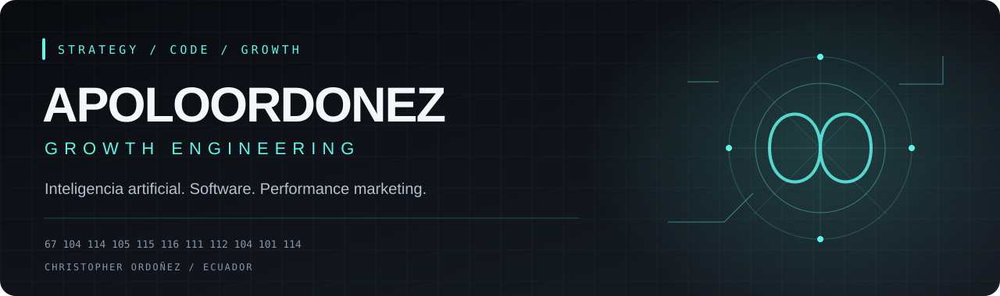

  

<strong>MARKETING CON ESTRATEGIA · TECNOLOGÍA CON PROPÓSITO</strong>

Christopher Ordoñez · Ecuador / Latinoamérica

  <a href="https://www.linkedin.com/in/apoloordonez">LinkedIn</a> &nbsp; / &nbsp;
  <a href="mailto:Apoloordonezec@gmail.com">Contacto profesional</a> &nbsp; / &nbsp;
  <a href="https://github.com/Apoloordonez11?tab=repositories">Explorar repositorios</a>

---

## 01 / Sobre mí

Conecto publicidad digital, desarrollo web e inteligencia artificial para construir experiencias enfocadas en adquisición, conversión y crecimiento.

Mi trabajo combina estrategia de marketing, creación de interfaces y desarrollo asistido por IA. Me interesa transformar una idea de negocio en una experiencia que se pueda construir, probar y mejorar.

**Áreas de enfoque:** performance marketing · landing pages · automatización · experiencias web · IA aplicada.

## 02 / Stack & herramientas

### Inteligencia artificial y desarrollo asistido

  
  
  
  
  

### Desarrollo web · tecnologías presentes en mis proyectos

  
  
  
  
  
  
  

### Sistemas y ecosistemas

  
  

### Performance marketing

  
  
  

Segmentación · pruebas A/B · embudos de conversión · Facebook Pixel · API de Conversiones · análisis de campañas.

## 03 / Proyectos seleccionados

| Proyecto | Enfoque | Tecnologías |
| :--- | :--- | :--- |
| [**León Brokers**](https://github.com/Apoloordonez11/Le-n-Brokers) | Interfaz comercial de asesoría y presentación de servicios | React · TypeScript · Vite |
| [**Sigma Marketing Digital 2026**](https://github.com/Apoloordonez11/Sigma-Marketing-Digital-2026) | Experiencia web para presentar un ecosistema de marketing y captación | React · TypeScript · Tailwind CSS |
| [**LoordEmpire**](https://github.com/Apoloordonez11/LoordEmpire) | Plataforma en desarrollo con autenticación e interfaces de dashboard | Next.js · Firebase · TypeScript |
| [**AURA-NEXUS**](https://github.com/Apoloordonez11/V1.-AURA-NEXUS) | Exploración de experiencias web e interfaces visuales | React · TypeScript · Vite |

Estos repositorios reúnen implementaciones y prototipos en evolución. Su publicación no implica que todas las integraciones estén activas en producción.

## 04 / Cómo trabajo

**Estrategia** — Definir el problema, el público y la acción que queremos facilitar.

**Construcción** — Crear interfaces y flujos con herramientas adecuadas al proyecto.

**Medición** — Conectar decisiones con datos y resultados verificables.

**Iteración** — Probar, aprender y mejorar la experiencia.

## 05 / Conectemos

Para conversar sobre adquisición digital, desarrollo web o IA aplicada a negocios:

**[LinkedIn](https://www.linkedin.com/in/apoloordonez)** · **[Apoloordonezec@gmail.com](mailto:Apoloordonezec@gmail.com)**

---

<code>67 104 114 105 115 116 111 112 104 101 114</code>

APOLOORDONEZ / GROWTH ENGINEERING

